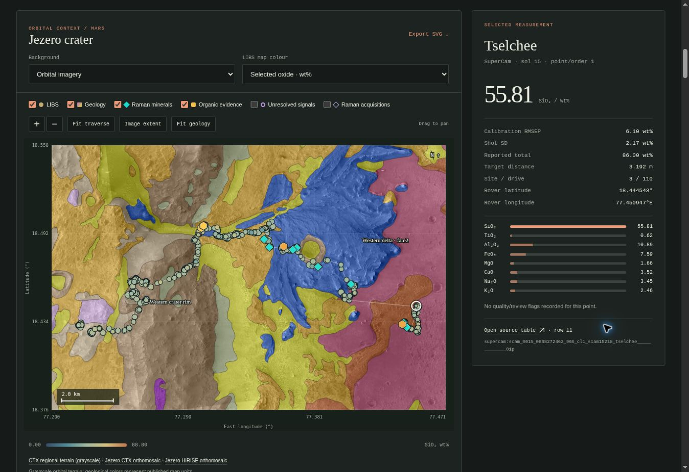

# Mars LIBS Explorer

An interactive field guide to the measured chemistry of Mars. Explore
NASA PDS ChemCam and SuperCam major-oxide predictions over real orbital imagery,
published geological maps, and selected Remote Micro-Imager (RMI) mosaics.
Compare the chemistry with ideal mineral stoichiometries, published Raman and
organic findings, and public Zhurong/MarSCoDe spectroscopy. The displayed data
are bundled with the website; a visitor does not need an API key or a live
connection to the source archives.

The visual approach is inspired by the editorial and interactive format of
[the airborne lidar field guide](https://sguergachi-tdy.github.io/airborne-lidar/lidar.html).
This project contains original application code and Mars science content.

## Initial bundled snapshot (16 November 2026)

Retrieved on 16 November 2026; coverage reflects the published MOC products.

| Instrument | Unique analysis points | Science points | Calibration points | Sol coverage | RMI examples / matched spots |
|---|---:|---:|---:|---|---|
| ChemCam | 31,175 | 30,797 | 378 | 13–4843 | 10 / 78 |
| SuperCam | 12,121 | 11,600 | 521 | 12–1859 | 3 / 20 |

SuperCam's 12,130 source rows include nine exactly duplicated records. The
ingest represents those records once and retains all original source row
numbers. ChemCam has 75 science points without an exact geographic join; they
remain available in chemistry views and exports. One of the 21 SuperCam image
annotations has no MOC composition and is displayed without a chemical value.

The additional spectroscopy snapshot contains:

| Layer | Included data | Meaning |
|---|---:|---|
| SuperCam Raman acquisition catalogue | 1,285 science product records in 166 observation groups; sols 57–1854 | Acquisitions, without automatic mineral assignments; 251 calibration product records excluded |
| Published mineral and organic evidence | 18 located examples | 8 Raman mineral findings, 7 organic detections, 2 organic interpretations, 1 unresolved fluorescence example |
| Zhurong LIBS supplements | 5 tables containing 90 rows | Published peak measurements; overlapping tables are not 90 independent observations |
| Zhurong SWIR supplements | 30 reflectance spectra, each with 309 wavelengths | 850–2390 nm at 5 nm intervals; source processing retained |

The 18 curated examples comprise 14 Perseverance observations and four
Curiosity SAM sample sites. All 166 Raman groups have an exact site/drive
localization join. A Raman product can contain several spectra or coadds, so
product counts are not counts of individual spectra or laser shots.

## Explore the upgraded atlas

- Pan and zoom over actual orbital imagery. Gale includes a color HiRISE
  mosaic; Jezero's bundled HiRISE/CTX orbital context is grayscale.
- Switch published geological layers on and off and adjust their opacity.
  Map extent and source limitations are stated with each layer.
- Color sampled rover positions by a selected oxide or derived bulk molar
  ratios. Compare individual spots with ideal mineral reference compositions.
- Enable Raman mineral findings, organic evidence, unresolved luminescence or
  the larger acquisition catalogue independently. Search the evidence cards,
  inspect provenance, locate a record on the map and export a CSV.
- Inspect the Zhurong LIBS signal tables and SWIR curves, and download their
  values. Their signal units remain separate from NASA oxide weight percent.

The evidence catalogue follows the selected NASA rover. Its search and category
filters are independent of the LIBS filters; enabled map evidence layers show
the mission's full bundled evidence catalogue. The white route connects sampled
rover locations and is not the complete navigation path.

## Open locally

Python 3 is enough to serve the finished website:

```bash
python -m http.server 8000 --directory dist
```

Open `http://localhost:8000`. A web server is required because browsers restrict
`fetch()` from files opened with `file://`. No npm installation or build step is
needed. The app uses modern browser Canvas, SVG, Fetch and, when available,
DecompressionStream. Uncompressed JSON is included as a fallback.

The downloadable GitHub ZIP includes the complete plain JSON and omits redundant
gzip companions to keep the archive compact. Its metadata selects the plain
transport directly. This changes no measurements, images or source identifiers.

## Upload through the GitHub website

Read [PHONE_SETUP.md](PHONE_SETUP.md) for the small-file upload and recovery
steps. This edition contains five ZIP files (`mars-part-01.zip` through
`mars-part-05.zip`), each below 10 MB, plus the matching `update-data.yml`.
Upload and commit each ZIP separately at the repository root, preserving its
filename and compressed contents. Install the updated workflow last at
`.github/workflows/update-data.yml`. The earlier two-part installer does not
recognize these five packages.

The **Update Mars data** workflow verifies and installs the complete project,
then checks public archives. It also runs daily at 08:00 in `America/Toronto`
and supports manual runs. The same workflow handles optional Pages publication.
It requests only the repository-content write access needed for its validated
commits. No personal access token, private Site credential, object store, or
scientific API key is needed. An Actions token never creates or edits workflows.

The complete source can also be uploaded conventionally from a computer.
Keep `.github`, `data`, `scripts`, and the complete `dist` folder at the root.

### Optional GitHub Pages website

Creating the repository and publishing a website are separate operations.
GitHub Pages is normally public, including when its source repository is
private. When you want the website published:

1. In **Settings → Pages**, select **GitHub Actions** as the publishing source.
2. Under **Settings → Secrets and variables → Actions → Variables**, create
   repository variable `ENABLE_PAGES` with the value `true`.
3. Run the **Update Mars data** workflow. Its optional Pages job publishes the site.
4. Use the actual website URL returned by the successful deployment.

Pages deployment is disabled while `ENABLE_PAGES` is absent or not `true`.
After it is enabled, the update workflow deploys the same validated bundle it
commits; it does not depend on a bot commit triggering another workflow.
GitHub Free supports Pages from public repositories; Pages from private
repositories requires an eligible plan. This GitHub deployment operates independently of any separately hosted instance.

The app uses relative asset paths and works under a repository subpath. Both
`index.html` and `mars-libs.html` open the explorer. See
[SCHEDULED_UPDATES.md](SCHEDULED_UPDATES.md) for operation and recovery.

Platform references: [GitHub Pages creation](https://docs.github.com/en/pages/getting-started-with-github-pages/creating-a-github-pages-site),
[workflow schedules](https://docs.github.com/en/actions/reference/workflows-and-actions/workflow-syntax#onschedule),
and [GITHUB_TOKEN event behavior](https://docs.github.com/en/actions/concepts/security/github_token).

## What the maps mean

**Terrain and geology.** Backgrounds are sourced orbital mosaics with documented
Mars georeferencing. The Gale LRGB colors are an enhanced source composite, not calibrated
natural-color measurements or chemical abundances. Regional CTX and Jezero HiRISE images remain grayscale.
Gale's detailed geological overlay covers the local Glen Torridon study area;
Jezero's regional map retains the published prelanding orbital interpretation.
These maps have different extents, scales and dates. Geological boundaries and
rover positions have their own alignment limits and do not determine the
material under every laser spot. The app does not extrapolate a local geological
map over the rest of the traverse.

**Rover context.** NASA measurement and evidence markers have documented
localization or named-workspace provenance. They represent rover positions
associated with measurements, not
the latitude and longitude of the laser footprint. Coincident observations are
aggregated for display; the marker color is the median of the selected oxide
over its included measurements. Measurements with no exact localization match
remain in the chemistry data. No geographic coordinates are inferred from
site/drive identifiers and no missing chemistry is interpolated.

**Rock context.** The curated RMI images show numbered sampling locations.
ChemCam image coordinates come from the official mosaic labels and are joined
to chemistry by spacecraft clock. SuperCam locations are digitized centers of
the official colored crosshair annotations. Their estimated digitization
precision does not quantify physical pointing or spot-placement uncertainty.
An annotated location without a composition record remains unmeasured in the
overlay. These are sparse point measurements, not full-image chemical maps.

**Chemistry.** Values are the published MOC predictions in oxide weight percent.
They are not renormalized to 100%. FeOT is total iron expressed as FeO equivalent;
it is not an iron oxidation-state measurement. The mission-specific calibrations
are preserved. Calibration prediction error (RMSEP) and shot-to-shot standard
deviation are reported separately; neither is labeled as a 95% confidence
interval or combined without a statistical model. Onboard calibration targets
are excluded by default. Review flags identify potential issues and do not by
themselves prove an analysis is invalid.

**LIBS interpretation.** The app converts nonnegative oxide estimates to cation
moles for a `Si + Al` / `Ca + Na + K` / `Fe + Mg` ternary comparison. It also
reports bulk `100 Mg/(Mg + total Fe)`, `(Ca + Fe + Mg)/Si`, `Al/Si` and
`(Fe + Mg)/Si`. Only the ternary plotting proportions are normalized; the
original oxide values and totals are unchanged. Ideal feldspar, pyroxene,
olivine and silica references provide chemical context, not fitted mineral
fractions or a unique mineral classification. The total-Fe Mg ratio does not
measure ferrous iron. Dust, mixtures, salts, glass and calibration error can
produce similar bulk compositions. No ratio confidence interval is calculated
without oxide covariance information.

**Raman and organic evidence.** An acquired Raman product is not a mineral
detection. Published mineral identifications, organic detections, PAH
interpretations and unresolved fluorescence have separate statuses. Curiosity
has no Raman spectrometer: its organic locations here are SAM sample sites.
The SHERLOC catalogue distinguishes Raman G-band observations from early UV
luminescence that has supported inorganic explanations. No organic abundance,
deposit boundary or biological origin is inferred. Symbols show rover/workspace
proxies; marker size is for visibility and does not represent a sampled area.

**Chinese data.** MarSCoDe provides LIBS, short-wave infrared spectroscopy and
microimaging. The included normalized LIBS peak areas are not oxide wt%, ppm,
mineral fractions or Raman intensities. The source supplements provide no
verified target coordinates, so their measurements remain unlocated. Rounded
Zhurong landing coordinates are context only and are not assigned to every
measurement. Hydrogen, sulfur or chlorine peaks alone do not identify organics.

The application is intended for data exploration. Geological interpretations
and quantitative comparisons should consider the source documentation,
calibration domains, observation geometry, target type and data-quality notes.

## Data and reproducibility

See [DATA_SOURCES.md](DATA_SOURCES.md) for authoritative archives and references.
Each `dist/data/<mission>.json` contains the retrieval timestamp, source URLs,
source hashes, release information, join notes, image provenance and chunk
checksums. The committed bundle records its source versions. The GitHub workflow checks sources daily after installation; a downloaded ZIP remains a snapshot until its updater runs.

The source-ingest programs are under `scripts/chemcam` and `scripts/supercam`.
To reproduce image and geography processing, install the optional
dependencies with `python -m pip install -r requirements.txt`. Those packages
are not needed to run the already-built website.
They download public products into a local `raw/` cache, retain source metadata,
and write a complete `data.json`. Read each ingest's own documentation before
refreshing, especially the rules for clearing cached sources. Current bundled
data are usable without running those downloads.

After generating both mission datasets:

```bash
python scripts/assemble_data.py --input-root scripts
python scripts/validate_bundle.py
```

Then reproduce the additional evidence, Chinese supplements and geography:

```bash
python scripts/spectroscopy/build_evidence.py --input-root scripts
python scripts/zhurong/ingest_zhurong.py
python scripts/geography/build_geography.py --cache /absolute/path/mars-geography-cache
```

Read [the spectroscopy notes](scripts/spectroscopy/README.md),
[the Zhurong importer notes](scripts/zhurong/README.md), and
[the geography notes](scripts/geography/README.md) before refreshing. The
spectroscopy builder downloads missing PDS metadata and joins exact positions.
The Zhurong importer can use its bundled original spreadsheets/archive and
verifies the publishers' MD5 checksums. Its importer and the spectroscopy
builder use the Python standard library. Geography processing has separate
raster/vector dependencies and can require substantial source downloads. The
full geography rebuild includes the Zhurong GIS layer and requires system GDAL
(`ogr2ogr`), installed separately from the Python requirements.

The CNSA primary Tianwen-1 archive requires registration. This project uses
public author-deposited supplements and does not include account-restricted
Level 2B data. A linked publisher concentration/metadata supplement could not be
downloaded during this build and is not imported. No missing concentration or
coordinate was synthesized from the available signal tables.

To regenerate the downloadable project after changes:

```bash
python scripts/export_project.py
```

The exporter writes `exports/mars-libs-github.zip` with the complete scientific
data, imagery, source programs, configuration and workflows. The local ZIP is
ignored by Git. On GitHub Pages, the **Download GitHub project** button links to
the actual repository archive. Local previews link to the setup guide. The
portable archive omits redundant gzip companions and selects plain JSON without
changing measurements or provenance.

`assemble_data.py` divides the measurements into small JSON assets, makes
byte-equivalent gzip companions, and copies the RMI display images. It changes
neither the chemistry nor the spatial joins. `validate_bundle.py` checks the
snapshot's counts, unique identifiers, image associations, source links, finite
numeric fields and gzip integrity.

## Use exported data in MATLAB

Use **Download CSV** after applying the desired filters, then read the file:

```matlab
T = readtable("your-downloaded-file.csv", VariableNamingRule="preserve");
disp(T.Properties.VariableNames)
```

CSV column names include oxide names and distinguish composition, RMSEP and
shot SD. Inspect the actual exported header before selecting columns. Preserve
the mission, product identifier, source-row identifier and localization kind
when combining datasets.

The evidence and Zhurong sections have their own CSV exports. Retain their
quantity names, source units, evidence statuses and position-proxy metadata.
Do not combine a normalized peak area with an oxide wt% column as though they
were the same physical quantity.

## Project structure

| Path | Purpose |
|---|---|
| `dist/index.html`, `dist/mars-libs.html` | Website entry points |
| `dist/app.js`, `dist/atlas.js`, `dist/styles.css` | Chemistry, geographical/evidence interactions and presentation |
| `dist/data/*.json` | Mission metadata, provenance and chunk lists |
| `dist/data/<mission>/` | Complete point measurements, plain and compressed |
| `dist/assets/<mission>/` | Real RMI images or documented display derivatives |
| `dist/data/spectroscopy.json` | Raman acquisition catalogue and curated mineral/organic evidence |
| `dist/data/zhurong.json`, `dist/data/zhurong_sources/` | Chinese spectroscopy, provenance and original public supplements |
| `dist/data/geography.json`, `dist/assets/geography/` | Basemap and geological-layer metadata, images and vector displays |
| `scripts/` | Reproducible ingest, packaging and validation |
| `PHONE_SETUP.md` | Phone upload, installation and optional website publication |
| `.github/workflows/update-data.yml` | Daily source checking, validation and data commits |
| `scripts/updates/run_github_daily.py` | Standalone updater without a private service token |
| `data/update-state.json` | Accepted public-source fingerprints |
| `dist/data/update-status.json` | Last source check and last validated data update |

Original application code is MIT licensed. That license does not replace source
data and image terms. The Luo and Zhang Zenodo supplements and the Fedo et al.
Glen Torridon source carry CC BY 4.0; retain their author credits, DOI links,
license notices and statements of processing. NASA, USGS, HiRISE, CTX and RMI
credits are recorded with their products. See DATA_SOURCES.md and each ingest's
README for source-specific terms and the transformations applied. This is an
independent explorer, not an official NASA, CNSA, USGS or instrument-team product.

## Geography preview



## Automatic source checks and data updates

The GitHub workflow stages new NASA data in a fresh copy, checks the chemistry, provenance, positions and Raman catalogue, and commits only a validated result. Last checked and last accepted data update are recorded separately. Failures preserve the previous science bundle, and historical revisions or changed scientific interpretations are held for review. The operating guide describes the exact source and retry behavior. A downloaded ZIP remains a snapshot until its workflow is uploaded and enabled in GitHub.
